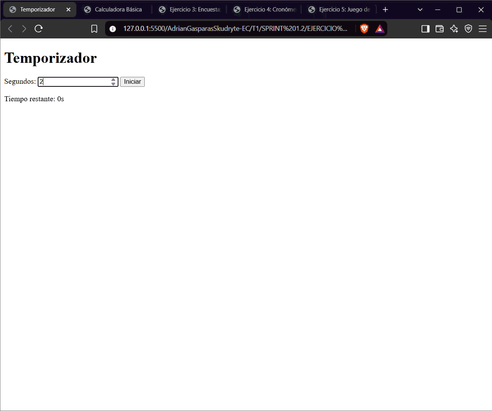
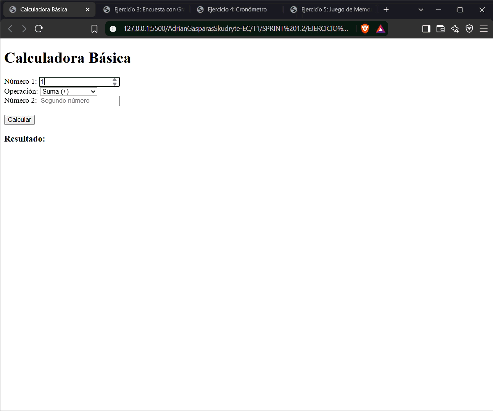
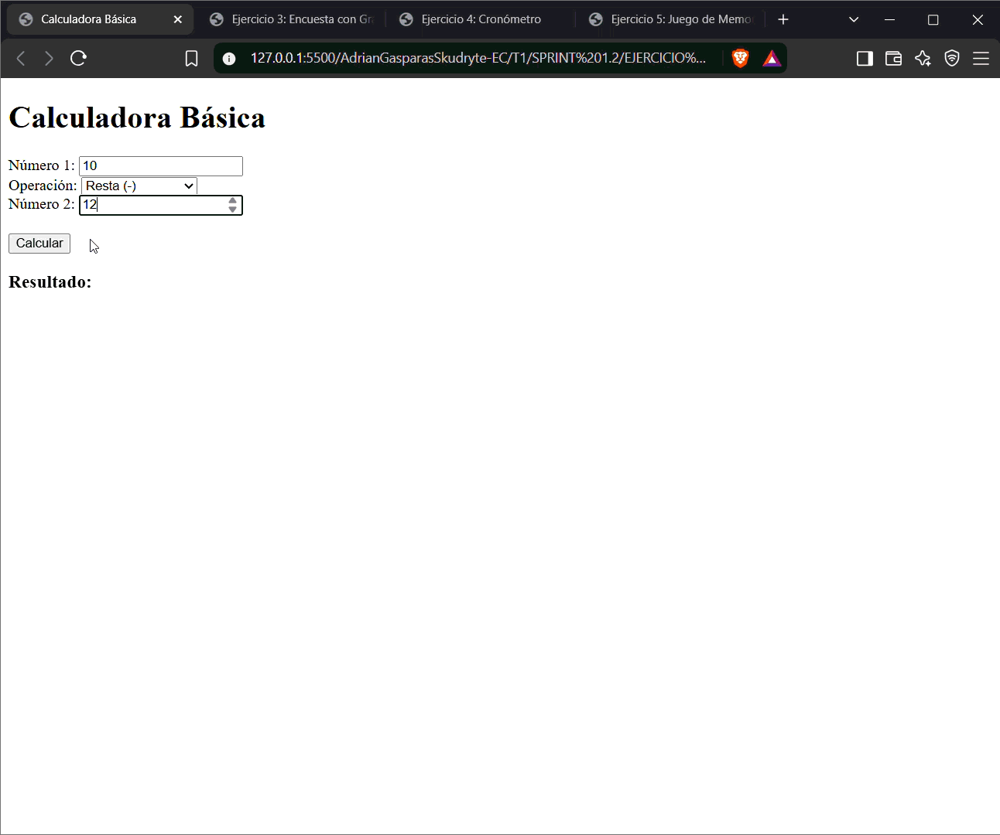
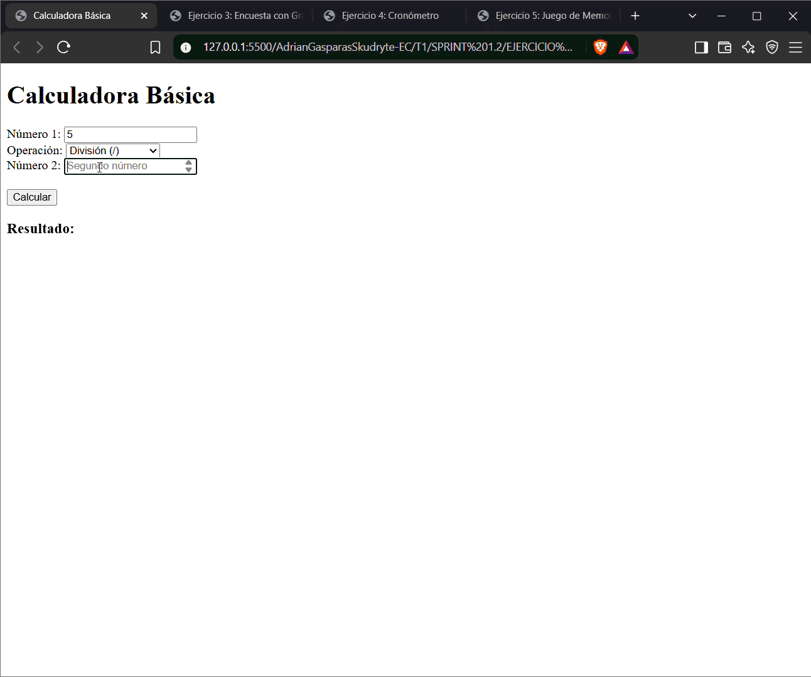
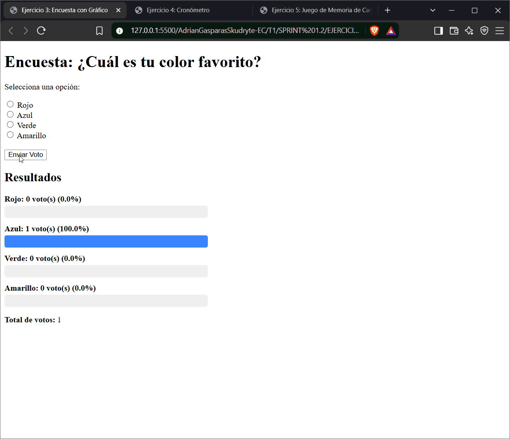
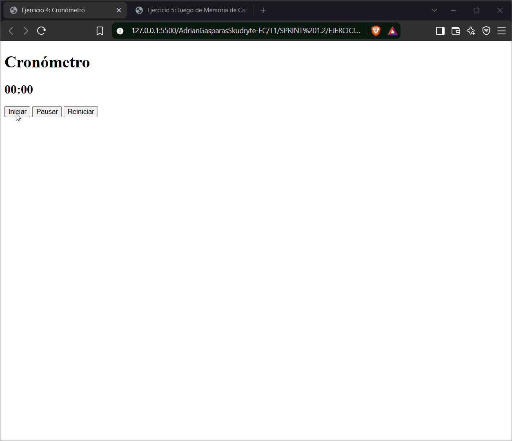
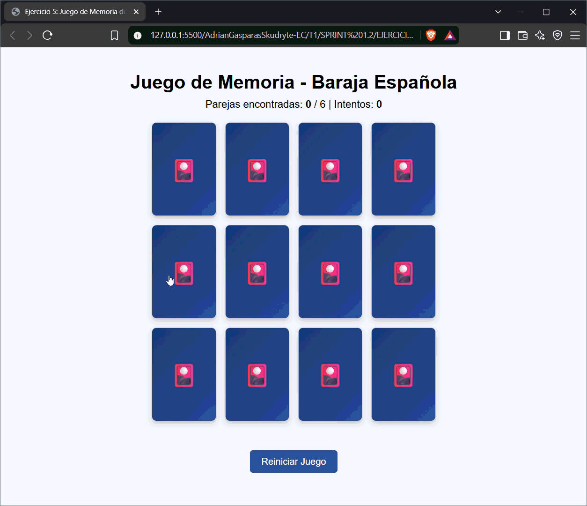
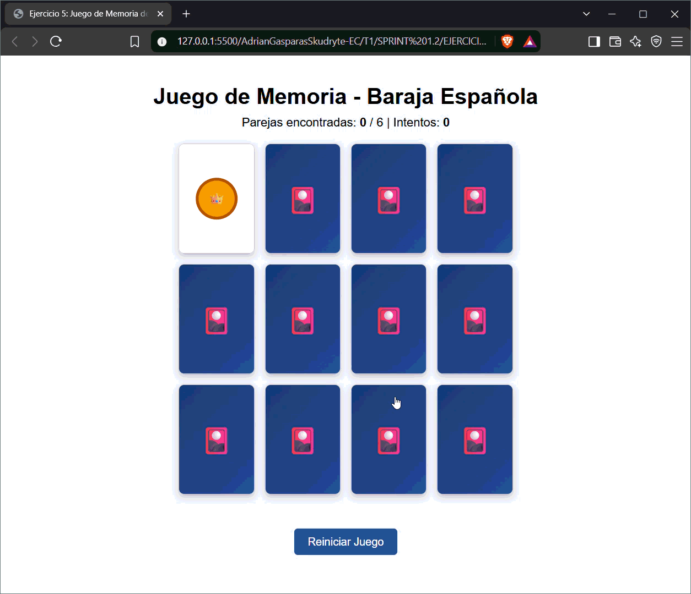
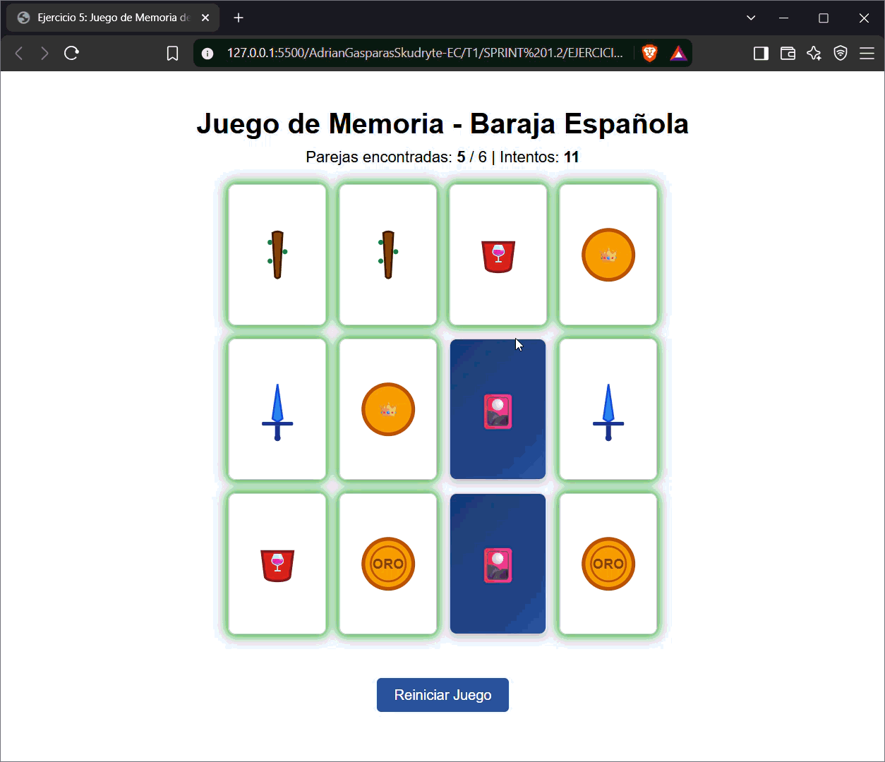
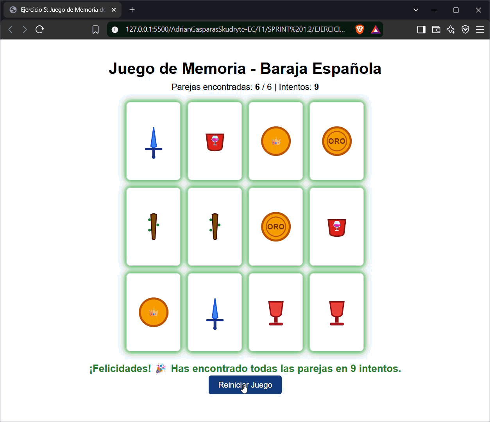

# SPRINT 1.2 - Eventos y Temporizadores en JavaScript

Este repositorio contiene los ejercicios correspondientes al **Sprint 1.2**. Cada ejercicio se encuentra organizado en su respectiva carpeta y cuenta con sus demostraciones dinámicas en formato GIF almacenadas en la carpeta `MEDIA/`.

---

## ⏱️ Ejercicio 1: Contrarreloj (Temporizador)
**Descripción:** Aplicación de cuenta regresiva donde el usuario ingresa un tiempo en segundos. Al hacer clic en "Iniciar", el sistema realiza la cuenta regresiva segundo a segundo y muestra una alerta flotante e imagen de finalización al llegar a cero.

- **Objetivos:** Eventos `click`, `setInterval`, `clearInterval` y manipulación del DOM.

### Demostraciones GIF:
* **Prueba 1 (2 segundos):** Cuenta regresiva de 2s mostrando la alerta al finalizar.
  
  

* **Prueba 2 (4 segundos):** Cuenta regresiva de 4s verificando la finalización y alerta.
  
  

---

## 🧮 Ejercicio 2: Calculadora Básica
**Descripción:** Calculadora interactiva que realiza operaciones aritméticas básicas (suma, resta, multiplicación y división) entre dos números ingresados por el usuario.

- **Objetivos:** Captura de eventos, validación de campos vacíos y operaciones matemáticas (+, -, *, /) incluyendo control de división por cero (`INDEFINIDO`).

### Demostraciones GIF:
* **Prueba 1 (Suma):** Verificación de 10 + 12 = 22.
  
  

* **Prueba 2 (Resta):** Verificación de 10 - 12 = -2.
  
  

* **Prueba 3 (Multiplicación):** Verificación de 5 x 4 = 20 y 5 x 0 = 0.
  
  

* **Prueba 4 (División):** Verificación de 5 / 4 = 1.25 y 5 / 0 = "INDEFINIDO".
  
  

---

## 📊 Ejercicio 3: Encuesta con Gráficos de Resultados
**Descripción:** Encuesta de selección múltiple sobre preferencias de color que genera y actualiza dinámicamente un gráfico de barras proporcional en tiempo real con cada voto recibido.

- **Objetivos:** Evento `click` en radio buttons, conteo de respuestas y actualización dinámica de elementos del DOM (`divs` porcentuales).

### Demostración GIF:
* **Demostración de votación y actualización gráfica:**
  
  

---

## ⌛ Ejercicio 4: Cronómetro
**Descripción:** Cronómetro digital con botones independientes de Inicio, Pausa y Reinicio que muestra el tiempo transcurrido en minutos y segundos (`MM:SS`).

- **Objetivos:** Manejo múltiple de eventos, `setInterval`, `clearInterval` y formateo dinámico del tiempo.

### Demostración GIF:
* **Demostración de flujo completo (Iniciar, Pausar, Reiniciar y tiempo prolongado):**
  
  

---

## 🃏 Ejercicio 5: Juego de Memoria con Cartas
**Descripción:** Juego interactivo de encontrar parejas de cartas con reverso y anverso. Si dos cartas seleccionadas no coinciden, se voltean nuevamente tras un breve intervalo de tiempo.

- **Objetivos:** `click` en elementos dinámicos, `setTimeout` para volteo temporal, comparación de estados y reinicio aleatorio de tablero (barajado).

### Demostraciones GIF:
* **Prueba 1 (Coincidencia de cartas):** Las parejas encontradas permanecen descubiertas.
  
  

* **Prueba 2 (Fallo de parejas):** Las cartas no coincidentes se voltean tras 1 segundo.
  
  

* **Prueba 3 (Victoria):** Detección de todas las parejas y mensaje de victoria.
  
  

* **Prueba 4 (Reinicio):** Reinicio del juego y mezcla aleatoria de cartas.
  
  