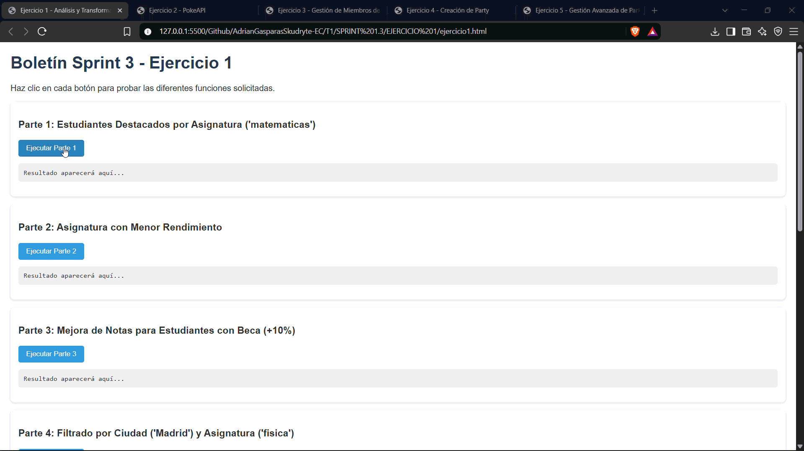
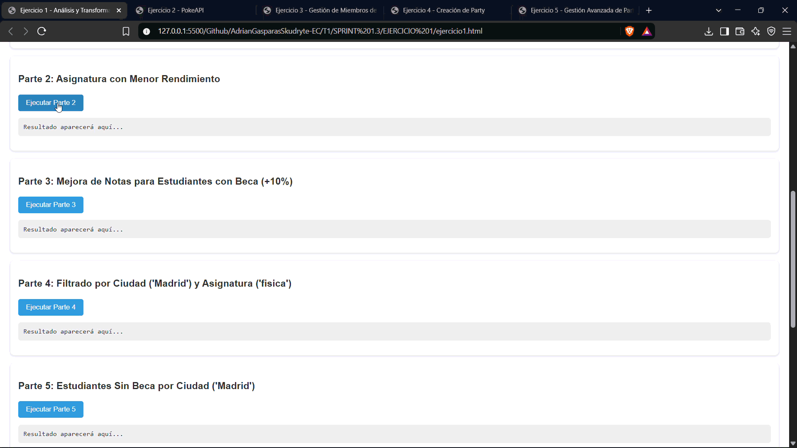
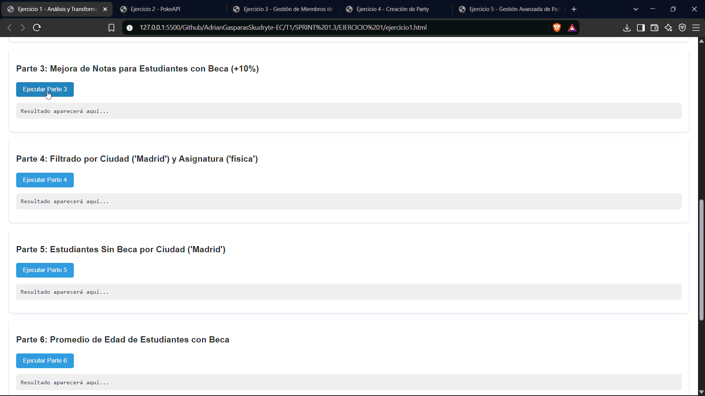
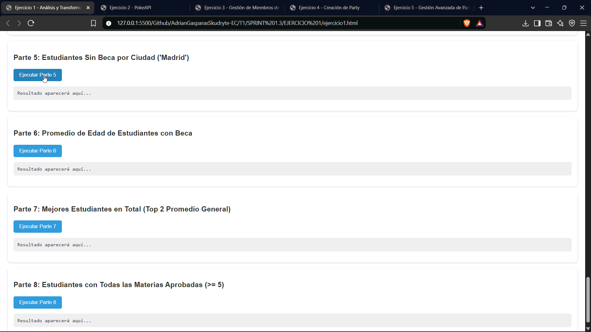
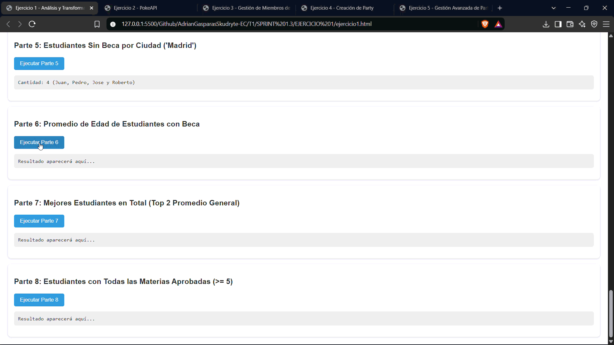
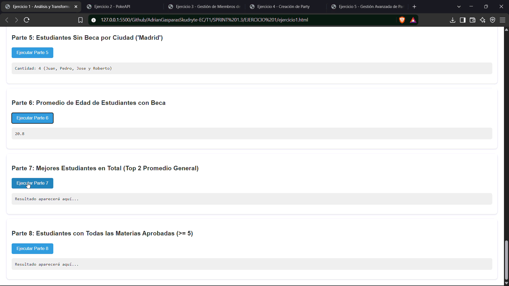

# Ejercicio 1 — Análisis y transformación de datos

La página [ejercicio1.html](./ejercicio1.html) permite ejecutar ocho operaciones sobre los datos de estudiantes: filtrar por asignatura y ciudad, calcular promedios, mejorar notas, ordenar resultados y aplicar condiciones de aprobado.

## Demostraciones

Se piden ocho pruebas. Seis GIF tienen contenido; las pruebas 1.4 y 1.8 están pendientes porque sus archivos están vacíos.

| Prueba | Operación | Evidencia |
| --- | --- | --- |
| 1.1 | Estudiantes destacados en matemáticas |  |
| 1.2 | Asignatura con menor rendimiento |  |
| 1.3 | Mejora de notas para estudiantes con beca |  |
| 1.4 | Filtrado por ciudad y asignatura | **Pendiente:** `Ejercicio1.4.gif` está vacío. |
| 1.5 | Estudiantes sin beca de Madrid |  |
| 1.6 | Promedio de edad de estudiantes con beca |  |
| 1.7 | Dos mejores estudiantes por promedio general |  |
| 1.8 | Estudiantes con todas las asignaturas aprobadas | **Pendiente:** `Ejercicio1.8.gif` está vacío. |

