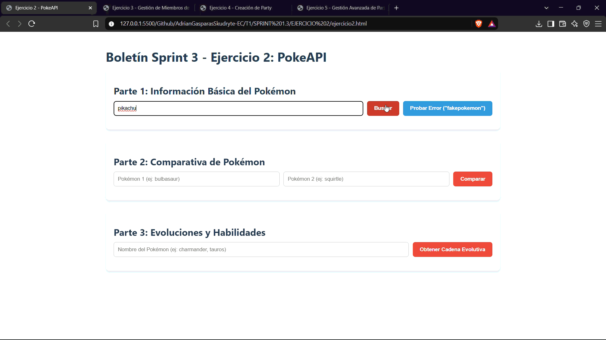
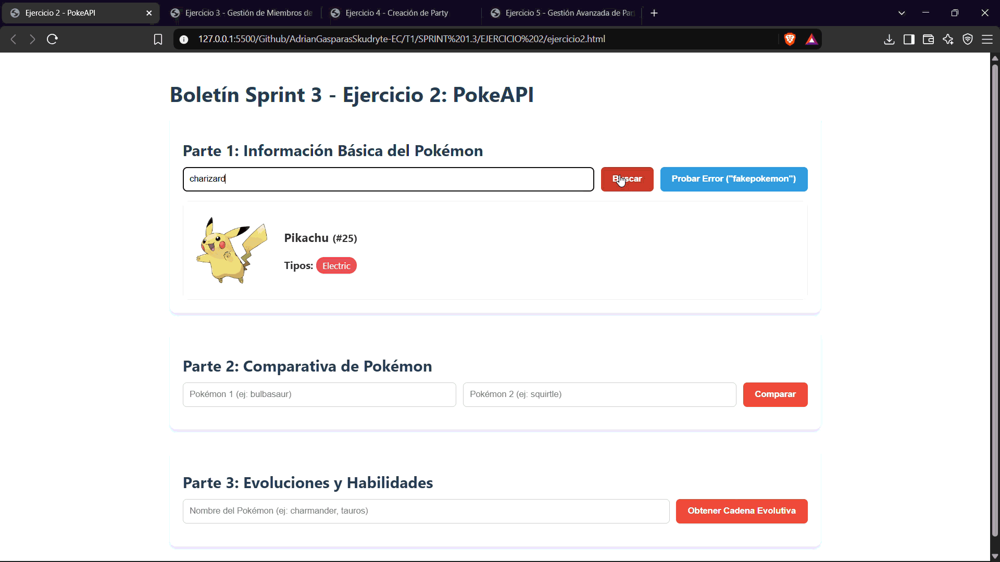
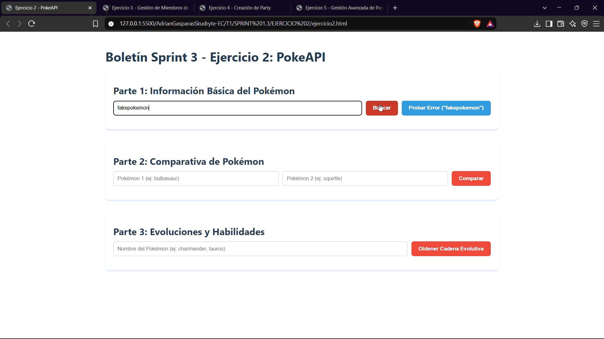
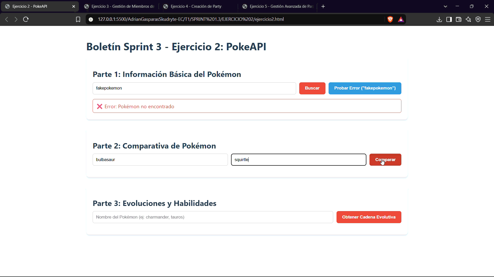
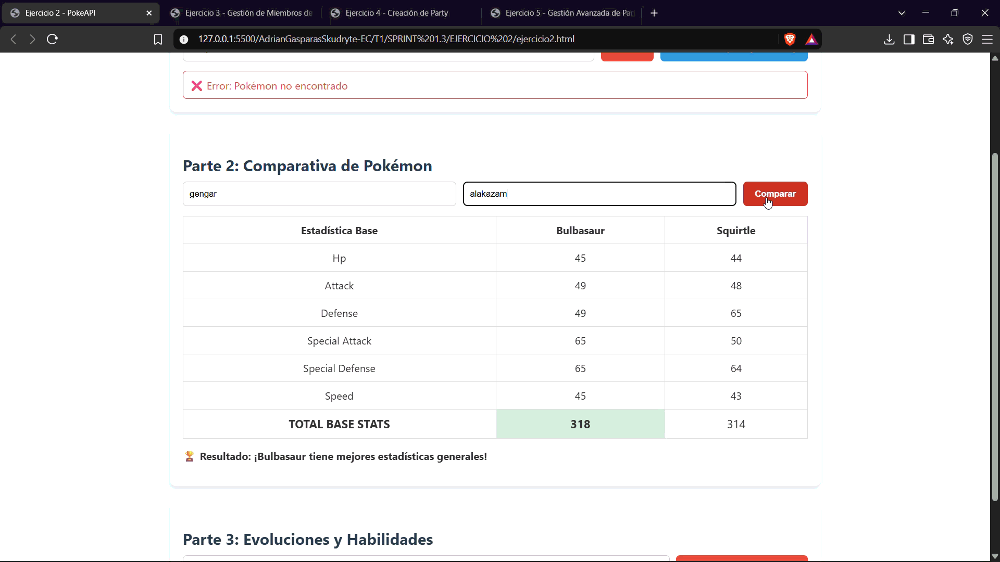
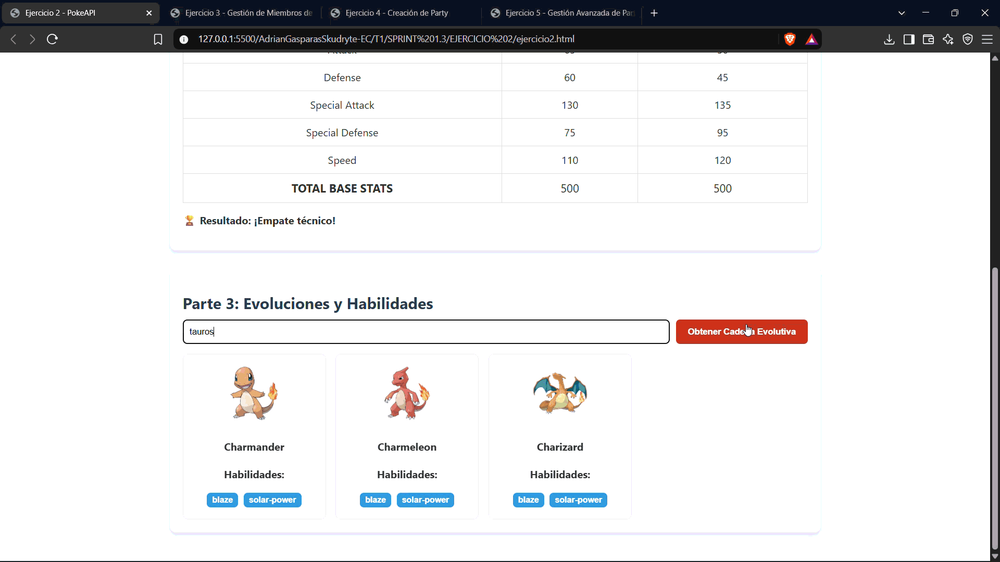

# Ejercicio 2 — PokeAPI

La página [ejercicio2.html](./ejercicio2.html) consume la [PokeAPI](https://pokeapi.co/) para consultar información básica de Pokémon, comparar sus estadísticas y mostrar sus evoluciones y habilidades.

## Demostraciones

Se piden siete pruebas. Seis GIF tienen contenido; la prueba 2.3.1 está pendiente porque su archivo está vacío.

| Prueba | Funcionalidad | Evidencia |
| --- | --- | --- |
| 2.1.1 | Consulta de información básica de un Pokémon |  |
| 2.1.2 | Gestión del error para un Pokémon inexistente |  |
| 2.1.3 | Otra consulta de información básica |  |
| 2.2.1 | Comparación de estadísticas entre dos Pokémon |  |
| 2.2.2 | Segunda prueba de comparación |  |
| 2.3.1 | Cadena evolutiva y habilidades | **Pendiente:** `Ejercicio2.3.1.gif` está vacío. |
| 2.3.2 | Segunda prueba de evoluciones y habilidades |  |

