# Ejercicios 3, 4 y 5 — Gestión de guild y Party Finder

Esta entrega reúne la gestión de miembros de la guild, la creación de parties y la gestión de sus integrantes. Las páginas son [Ejercicio 3](./ejercicio3.html), [Ejercicio 4](../EJERCICIO%204/ejercicio4.html) y [Ejercicio 5](../EJERCICIO%205/ejercicio5.html).

Los ejercicios 3 a 5 usan la API local en `http://localhost:3000`; las operaciones de datos requieren que la API y MySQL estén iniciados y configurados con el esquema del proyecto.

## Ejercicio 3 — Miembros de la guild

Permite listar, crear, editar y eliminar miembros, con validaciones del formulario.

| Prueba | Evidencia |
| --- | --- |
| 3.1 | 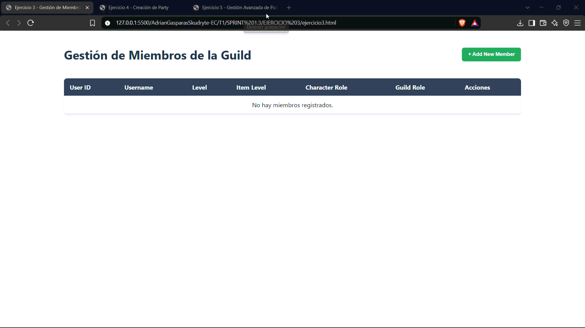 |
| 3.2 | 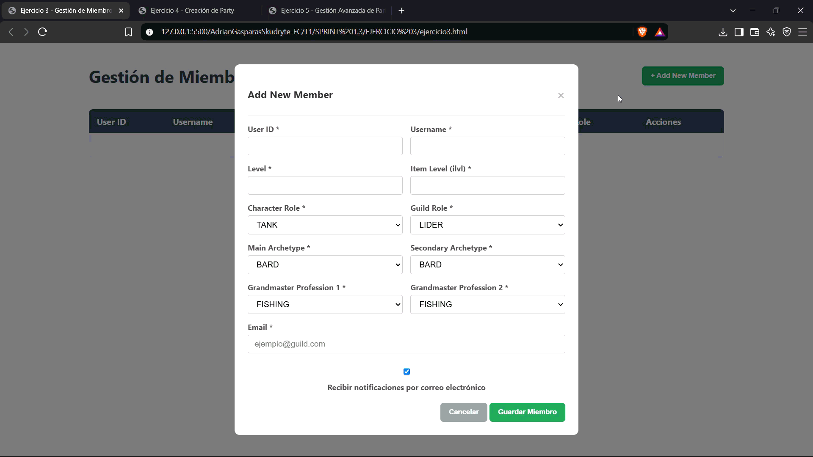 |
| 3.3 | 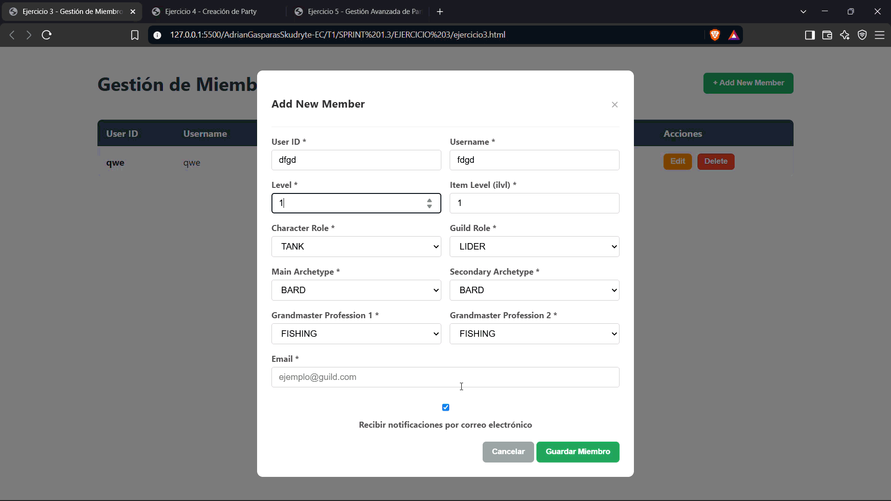 |
| 3.4 |  |
| 3.5 | 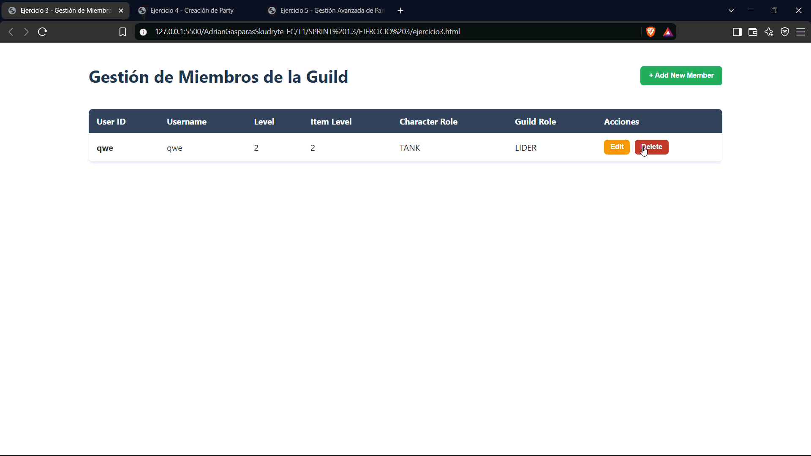 |
| 3.6 | 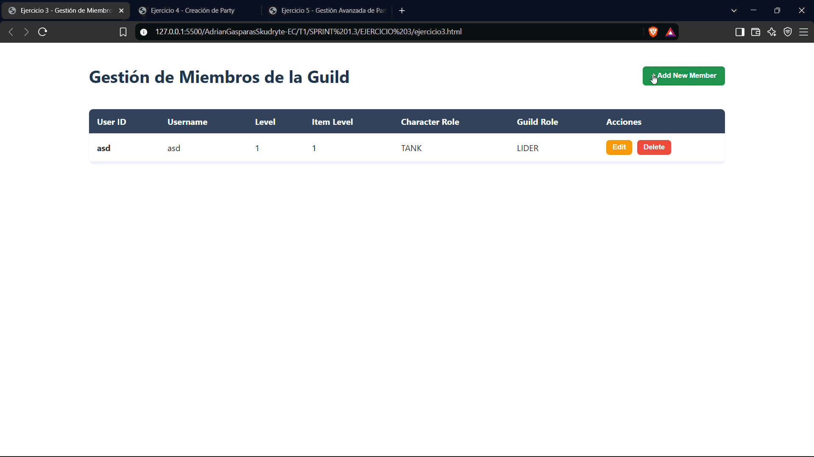 |

## Ejercicio 4 — Creación de parties

Permite crear parties de tamaño 3, 5 u 8, validando al creador, los límites de nivel y el formato y fecha de inicio.

| Prueba | Evidencia |
| --- | --- |
| 4.1 | 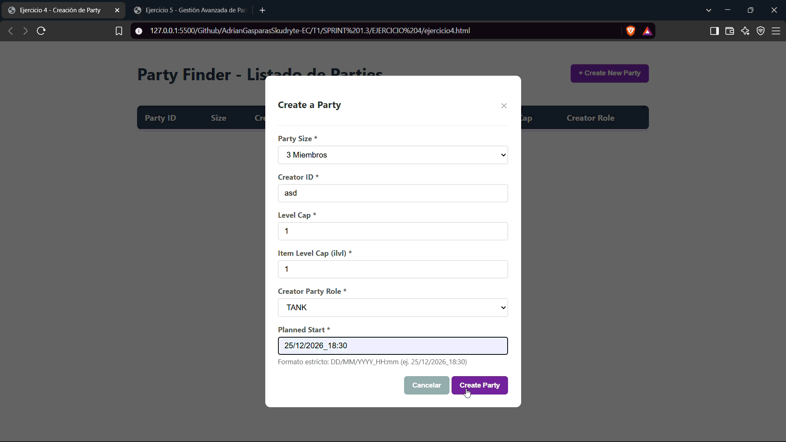 |
| 4.2 | 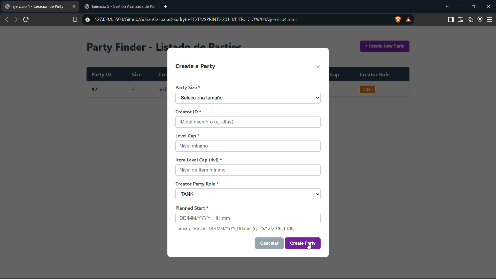 |
| 4.3 | **Pendiente:** `Ejercicio4.3.gif` está vacío. |
| 4.4 | 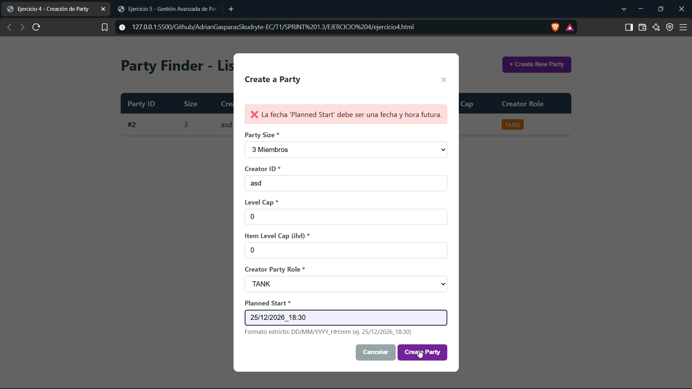 |
| 4.5 | 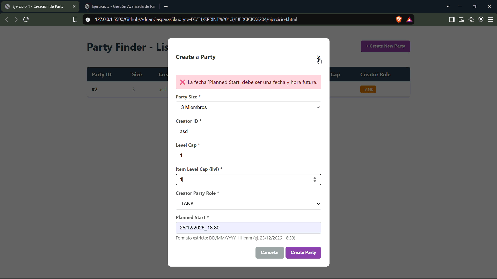 |

## Ejercicio 5 — Gestión avanzada de parties

Permite cargar una party, consultar sus integrantes, validar y añadir miembros en slots disponibles, y remover miembros con las restricciones correspondientes. La incorporación se realiza mediante el endpoint de la API; el esquema de la base de datos usa tablas específicas por tamaño de party.

| Prueba | Evidencia |
| --- | --- |
| 5.1 | 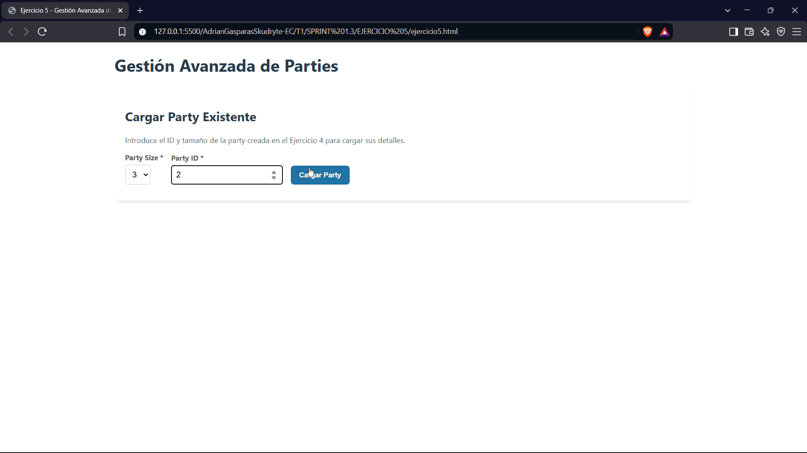 |
| 5.2 | 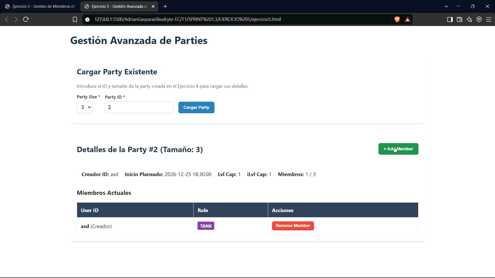 |
| 5.3 | 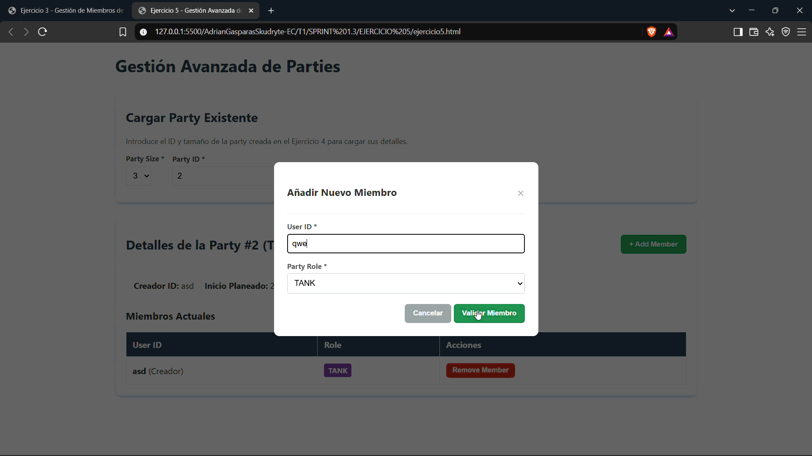 |

**Resumen de evidencias:** 13 GIF con contenido de los ejercicios 3, 4 y 5; queda pendiente únicamente la prueba 4.3.
