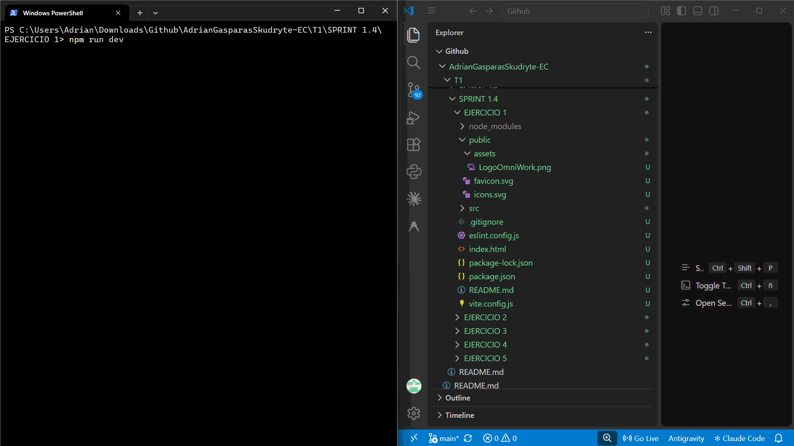
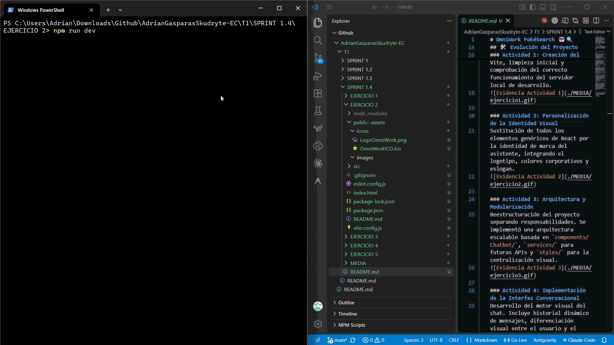
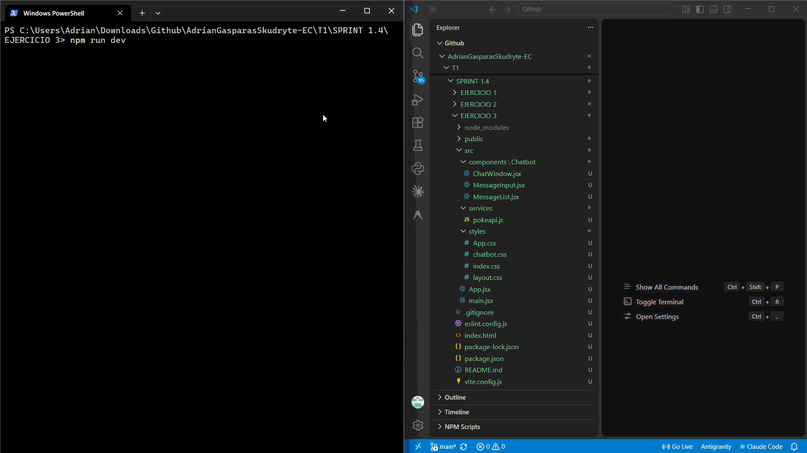
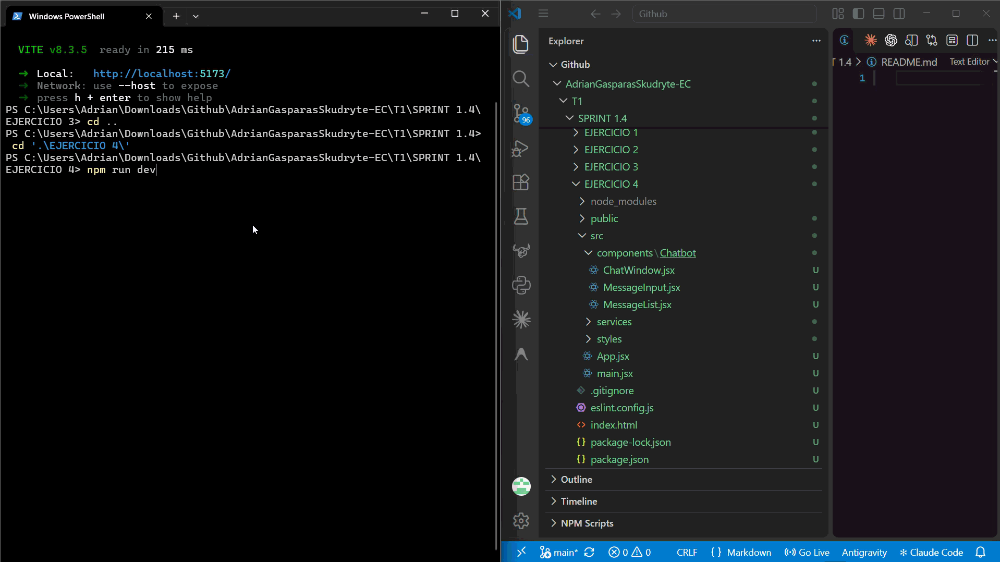
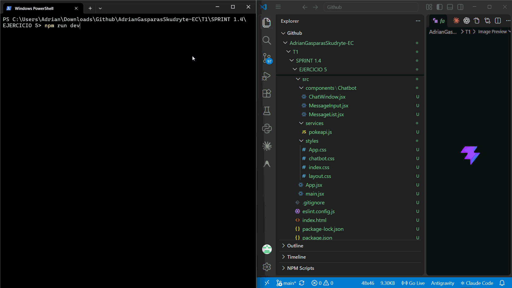

# OmniWork PokéSearch 🤖🔍

Un asistente virtual desarrollado en React con Vite que funciona como buscador inteligente de Pokémon. Este proyecto demuestra la evolución desde la creación de la estructura base hasta la integración de una API externa con una interfaz conversacional fluida y manejo de errores.

## 🚀 Tecnologías

* **Core:** React + Vite
* **Lenguaje:** JavaScript (ES6+)
* **Estilos:** CSS3 (Layout y modularización por componentes)
* **Datos Externos:** PokéAPI REST

---

## 🛠️ Evolución del Proyecto (Sprints)

### Actividad 1: Creación del Proyecto y Entorno
Generación del proyecto base con Vite, limpieza inicial y comprobación del correcto funcionamiento del servidor local de desarrollo.


### Actividad 2: Personalización de la Identidad Visual
Sustitución de todos los elementos genéricos de React por la identidad de marca del asistente, integrando el logotipo, colores corporativos y eslogan.


### Actividad 3: Arquitectura y Modularización
Reestructuración del proyecto separando responsabilidades. Se implementó una arquitectura escalable basada en `components/Chatbot/`, `services/` para futuras APIs y `styles/` para la centralización visual.


### Actividad 4: Implementación de la Interfaz Conversacional
Desarrollo del motor visual del chat. Incluye historial dinámico de mensajes, diferenciación visual entre el usuario y el bot, y simulación de respuestas con estados de carga ("Pensando...").


### Actividad 5: Integración con PokéAPI
Conexión de la interfaz con datos reales. El chatbot procesa búsquedas por nombre o número, traduce tipos al español, devuelve el sprite oficial del Pokémon y maneja correctamente los errores cuando no se encuentran resultados.


---

## ⚙️ Instalación y Ejecución

1. Clona el repositorio y navega hasta la carpeta del proyecto.
2. Instala las dependencias necesarias:
   ```bash
   npm install