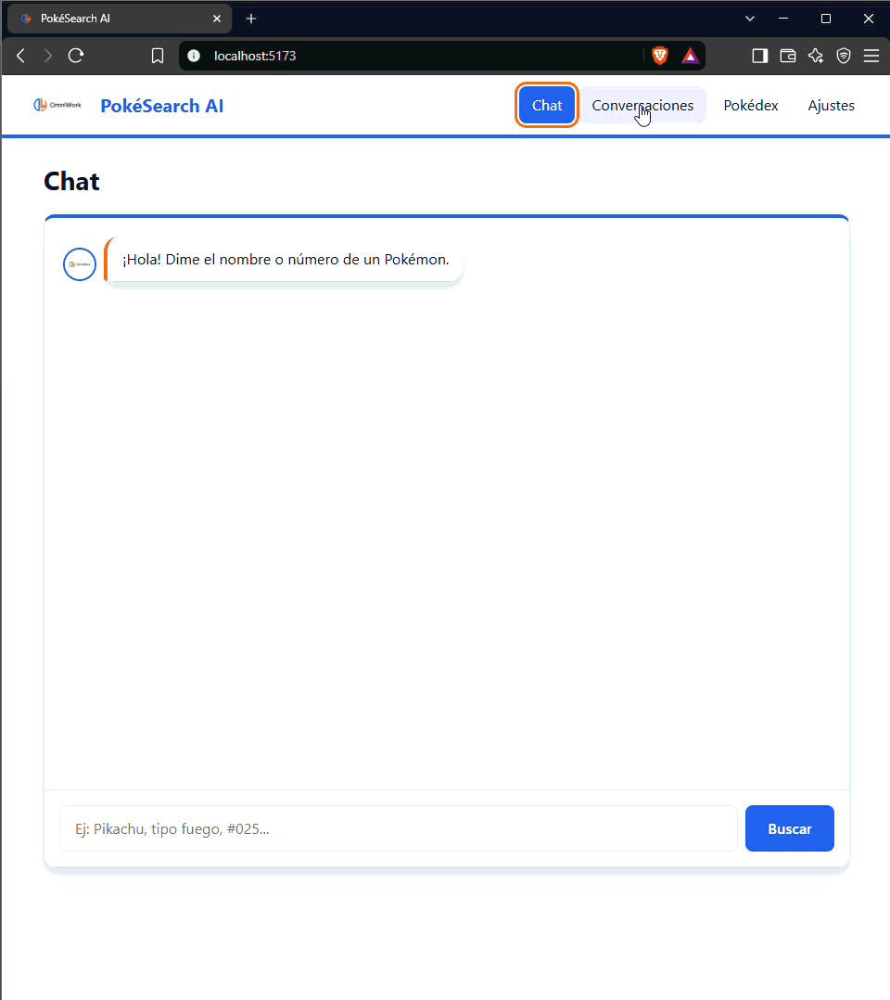
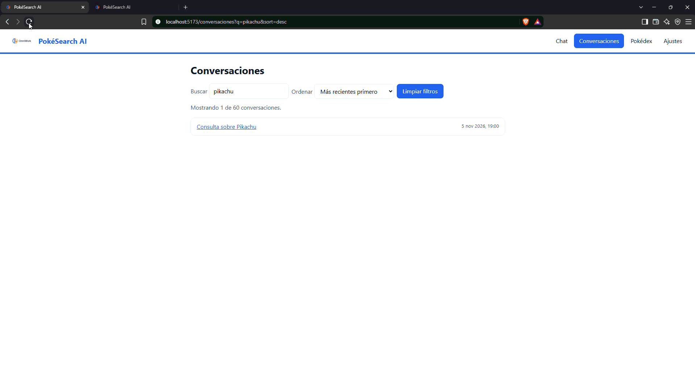
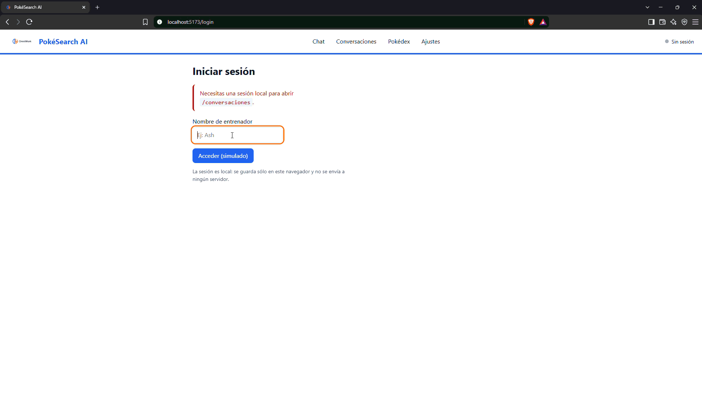
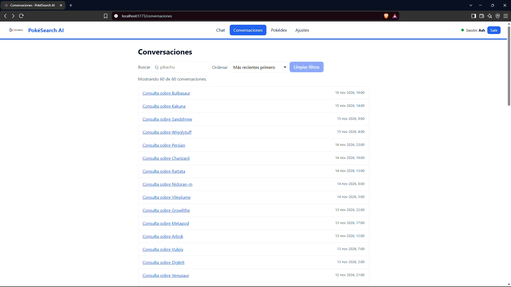
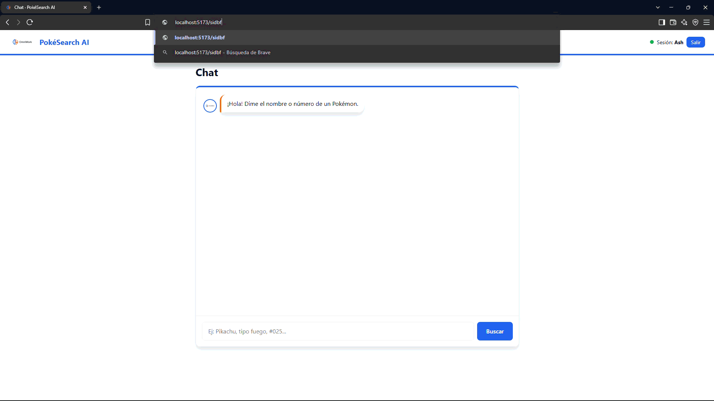
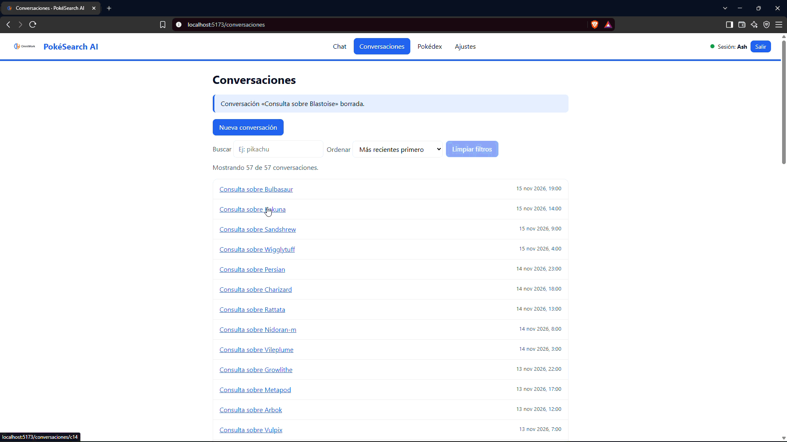

# OmniWork PokéSearch 🤖🔍 · Sprint 1.5: Navegación y enrutado

Continuación del asistente PokéSearch del Sprint 1.4 (React + Vite + PokéAPI). En este sprint se convierte en una aplicación de varias pantallas con **React Router 7**: rutas, parámetros en la URL, rutas protegidas, historial, errores y deep-linking.

Cada carpeta `EJERCICIO N` es un proyecto independiente que parte del anterior y le añade lo que pide su actividad.

## 🗺️ Mapa de rutas (versión final)

| Ruta | Vista | Acceso |
|------|-------|--------|
| `/login` | Login simulado | 🌐 Pública |
| `/` | Chat | 🔒 Sesión |
| `/conversaciones?q=&sort=` | Listado de conversaciones | 🔒 Sesión |
| `/conversaciones/:id` | Conversación (historial + chat) | 🔒 Sesión |
| `/pokedex?pagina=&fallo=` | Pokédex (PokéAPI) | 🔒 Sesión |
| `/ajustes` | Ajustes del asistente | 🔒 Sesión |
| `*` | 404 | 🌐 Pública |

## 🛠️ Actividades

### Actividad 1: Mapa de rutas y contenedores funcionales
Definición de las rutas, layout común con cabecera persistente y barra de navegación accesible por teclado.


### Actividad 2: Enrutado con parámetros, queries y estados
`/conversaciones/:id`, búsqueda `?q=` y orden `?sort=` sincronizados en los dos sentidos con la URL. Ver `EJERCICIO 2/src/services/url-state.md`.


### Actividad 3: Rutas protegidas (guards) y redirecciones
Sesión local simulada, guarda `RequireAuth` y redirecciones predecibles tras el login y el logout. Ver `EJERCICIO 3/src/components/Navigation/Guards.md`.


### Actividad 4: Historial, restauración de scroll y foco
Atrás/Adelante sin estados rotos, el scroll del listado se restaura, el foco va al input del chat o al título de cada vista, y los cambios de vista se anuncian a los lectores de pantalla.


### Actividad 5: Errores, 404 y estados de carga unificados
Vista 404, componentes comunes `Loading` y `ErrorBlock`, y simulación de un fallo de la PokéAPI.


### Actividad 6: Deep-linking y navegación programática
Conversaciones persistentes que se abren por URL, acciones Nueva/Duplicar/Borrar y estado "no encontrada".


## ✅ Criterios globales

- La URL siempre refleja la pantalla y su estado relevante (id, filtros, página).
- Ningún flujo queda bloqueado: la cabecera siempre está visible, y el 404, los errores y los estados vacíos ofrecen volver a Inicio/Chat.
- Atrás/Adelante funciona: las redirecciones y las acciones destructivas usan `replace`.
- Los estados de carga y de error se ven en la propia vista, sin mirar la consola.

## ⚙️ Instalación y ejecución

```bash
cd "EJERCICIO 6"   # o el ejercicio que se quiera probar
npm install
npm run dev
```
